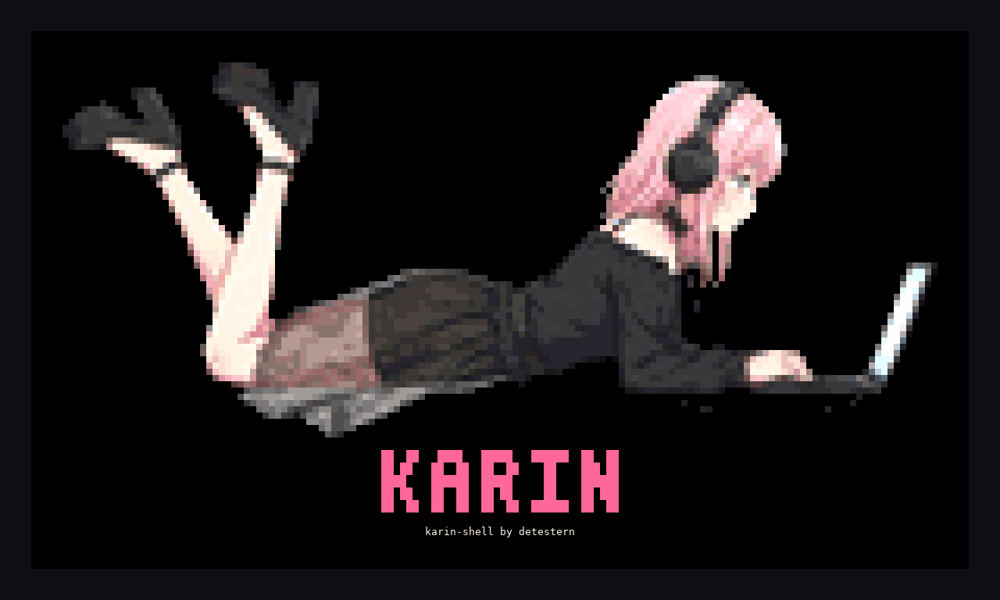

<div align="center">



# karin-shell

**Цельный рабочий стол на Hyprland для Arch Linux — запускается одним словом из TTY.**

Hyprland (Lua-конфиг) · Brain Shell на Quickshell · hyprlock · hypridle · тёмно-розовый уютный сетап с Карин

[English version](README.md)

</div>

---

## ✨ Что внутри

- **Запуск одной командой** — входишь в TTY, пишешь `karin-shell`, Карин собирается из символов, и ты на рабочем столе.
- **Конфиг Hyprland целиком на Lua** (0.55+) — маленькие модули, все пути в одном файле, личные правки в отдельном `local.lua`.
- **Brain Shell** (Quickshell) — панель, дашборд, лаунчер, буфер обмена, медиа, сеть и звук. Плюс дополнения karin-shell:
  - **Config → Theme** — акцент, рамки окон, скругления, отступы, прозрачность панели, курсор, иконки, тёмный режим. Одна кнопка применяет тему к Hyprland, оболочке, GTK- и Qt-программам.
  - **Config → Desktops** — сколько столов создаётся при запуске и какие программы на них открываются; можно закрепить программу «всегда на этом столе».
  - **Попап мониторов** — подключил экран, выбрал слева / справа / сверху / зеркало / выкл, масштаб и режим на живой схеме. Галочка «Запомнить» — и больше не спросит.
  - **Вкладка KarinCore** — «живое ядро» из [KarinCore](https://github.com/detestern/KarinCore) прямо в дашборде: подключение в одно касание, смена профиля из списка, текущий IP. Если KarinCore не установлен — вкладка подскажет, как его поставить.
  - Индикатор раскладки в панели.
- **Умные окна** — терминал открывается плавающим по центру, утилиты и диалоги плавающие, широкие TUI (`btop`, `sigye`, `cava`…) сами уходят в плитку, полноэкранное видео не даёт экрану заснуть.
- **Блокировка и сон** — hyprlock с Карин, затемнение → блокировка → экран off → сон, закрыл крышку — блокировка.
- **Обои в комплекте** — два набора, *anime* и *nature*, смена по `Super+W`.

## 📦 Установка

> Нужно: **Arch Linux** (или производный), обычный пользователь с `sudo` и AUR-помощник (`yay` или `paru`) для пары пакетов.

```bash
git clone https://github.com/detestern/karin-shell
cd karin-shell
./install.sh
```

Потом выйди из сессии, переключись в TTY и набери:

```bash
karin-shell
```

Установщик:

1. ставит зависимости через `pacman` и AUR-помощник (спрашивает перед этим);
2. копирует конфиг в `~/.config/karin-shell`, оболочку и обои — в `~/.local/share/karin-shell`;
3. кладёт команду `karin-shell` в `~/.local/bin`;
4. делает бэкап всего, что заменяет, и **не трогает** обычный `~/.config/hypr` — команда `Hyprland` работает как раньше.

| Команда | |
|---|---|
| `./install.sh --update` | обновить файлы, сохранив твою тему / столы / мониторы |
| `./install.sh --link` | режим разработки: симлинки на этот репозиторий |
| `karin-shell update` | `git pull` + обновление разом |
| `./uninstall.sh` | удалить karin-shell (спросит перед удалением, сделает бэкап) |

## ⌨️ Хоткеи

| Клавиши | Действие |
|---|---|
| `Super + Enter` | терминал (kitty) |
| `Super + D` | приложения |
| `Super + S` / `T` / `C` | дашборд / канбан / настройки |
| `Super + W` | обои |
| `Super + V` | история буфера обмена |
| `Super + M` | микшер звука |
| `Super + Esc` | меню питания |
| `Super + Q` | закрыть окно |
| `Super + F` | на весь экран |
| `Super + ↑` / `↓` | плавающее по центру / обратно в плитку |
| `Super + 1…9` | перейти на стол (`+ Shift` — перенести туда окно) |
| `Super + Tab`, `Super + ← / →` | следующий / предыдущий стол |
| `Super + N` / `Super + Shift + N` | новый стол / закрыть текущий дополнительный |
| `Super + A` | «телепорт» окна на стол |
| `Super + H` | окно на другой монитор |
| `Super + Shift + P` | настройка монитора |
| `Super + L` | блокировка |
| `Super + Shift + C` | перечитать конфиг |
| `Super + Shift + E` | выход |
| `Print` / `Shift + Print` | скрин области → буфер / весь экран → `~/Pictures` |
| `Super + Alt + W/B/G/H/S/I` | Wi-Fi / Bluetooth / VPN / точка доступа / вывод / ввод звука |
| `Alt + F9` | запись экрана |

Хоткеи Brain Shell переназначаются в **Super + C → Config → Keybinds**.

## 🎨 Настройка

| Что | Где |
|---|---|
| Цвета, рамки, отступы, курсор, иконки | `Super + C` → **Theme** |
| Столы и программы при запуске | `Super + C` → **Desktops** |
| Внешние мониторы | просто подключи, или `Super + Shift + P` |
| Заставка | `karin-shell demo`, `karin-shell effect decrypt\|matrix\|scan\|random`, `karin-shell art laptop\|knees\|photos\|standing` |
| Масштаб экрана, раскладки, свои хоткеи и правила | `~/.config/karin-shell/local.lua` (пример — `local.lua.example`) |

## 🗂 Структура

```
karin-shell/
├── install.sh / uninstall.sh
├── config/                 → ~/.config/karin-shell
│   ├── hyprland.lua        точка входа (только подключает модули)
│   ├── modules/            paths · look · input · monitors · rules · autostart · binds · theme · desktops
│   ├── scripts/            хранилища темы / столов / мониторов, утилиты
│   ├── intro/              заставка в TTY + арты
│   ├── assets/             экран блокировки, аватар, логотипы fastfetch
│   ├── hyprlock.conf, hypridle.conf
│   └── bin/karin-shell     команда запуска
├── shell/                  → ~/.local/share/karin-shell/shell   (Brain Shell, Quickshell)
└── wallpapers/             → ~/.local/share/karin-shell/wallpapers
```

## 🙏 Благодарности

- **[Brain Shell](https://github.com/Brainitech/Brain_Shell)** от Venkat Saahit Kamu (Brainitech) — оболочка на Quickshell, на которой построен проект, лицензия MIT (`shell/LICENSE`).
- [Hyprland](https://hypr.land), [Quickshell](https://quickshell.org), [matugen](https://github.com/InioX/matugen), [awww](https://codeberg.org/LGFae/awww).
- Обои принадлежат их авторам и включены только для личного использования.

## 📄 Лицензия

[MIT](LICENSE) © detestern
